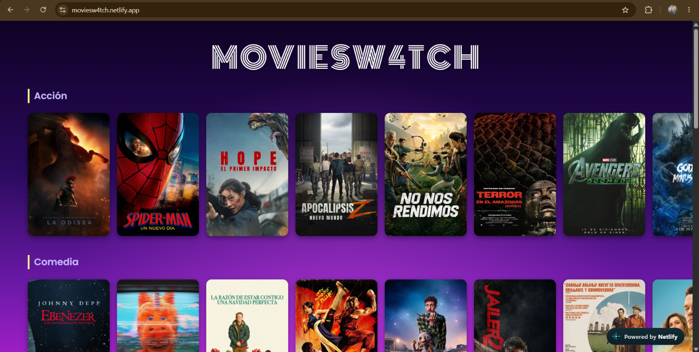
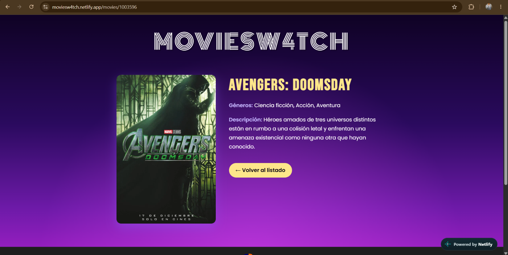
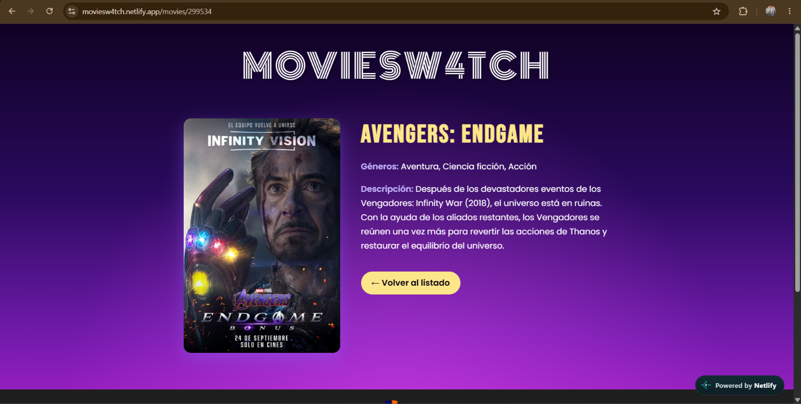

# MoviesW4tch - Práctica 7: App de películas con React

Aplicación web de películas desarrollada con **React + Vite**, que consume la API de **TMDB**, organiza las películas por género en filas horizontales (estilo Netflix) y muestra el detalle de cada película. Publicada en Netlify.

| Dato | Información |
|---|---|
| **Materia** | Desarrollo de aplicaciones Web en la nube y móviles |
| **Profesor** | Gutierrez Cobián Zeus Emanuel |
| **Calendario escolar** | 2026B |
| **Mes y año** | Noviembre 2026 |
| **Institución** | CUCEI - Universidad de Guadalajara |
| **Modalidad** | Individual |

---

## 1. Nombre del proyecto

**MoviesW4tch**= Práctica 7: Aplicación web de películas con React, Vite, React Router, API externa, GitHub y Netlify.

## 2. Integrantes del equipo

- Sanchez Rodriguez Karen Itzell (trabajo individual)

## 3. Objetivo

Desarrollar una aplicación web en React usando Vite como entorno de desarrollo, que consuma información de una API de películas, muestre un listado y el detalle de cada película, y que sea trabajada con GitHub y publicada en Netlify.

## 4. Tecnologías utilizadas

- **React** (componentes, props y hooks `useState`, `useEffect`, `useRef`, `useParams`)
- **Vite** (creación y compilación del proyecto)
- **React Router DOM** (navegación entre páginas)
- **JavaScript / JSX** y **CSS**
- **API de TMDB** (The Movie Database)
- **Git y GitHub** (control de versiones)
- **Netlify** (despliegue)
- **Google Fonts**: Monoton (título), Bebas Neue (títulos del detalle) y Poppins (texto general)

## 5. Estructura general del proyecto

```
practica7-react-peliculas/
├── public/
│   └── _redirects            # Regla para que React Router funcione en Netlify
├── src/
│   ├── components/
│   │   ├── Footer.jsx / .css       # Pie de página con datos del curso
│   │   ├── GenreRow.jsx / .css     # Fila horizontal de películas por género
│   │   ├── MovieCard.jsx / .css    # Tarjeta de película (póster + título al pasar el cursor)
│   │   └── MovieGrid.jsx / .css    # Cuadrícula de la primera versión (ya no se usa)
│   ├── pages/
│   │   ├── LandingPage.jsx         # Página principal con las filas por género
│   │   └── MovieDetails.jsx / .css # Vista de detalle de una película
│   ├── routers/
│   │   └── AppRouter.jsx           # Definición de las rutas
│   ├── services/
│   │   └── httpClient.js           # Función para consultar la API de TMDB
│   ├── utils/
│   │   └── getMovieImg.js          # Arma la URL del póster
│   ├── img/                        # Imagen de respaldo y escudo de CUCEI
│   ├── App.jsx / App.css
│   ├── main.jsx
│   └── index.css
├── .env                            # API key
└── package.json
```

## 6. Instalación y ejecución local

1. Clonar el repositorio:
   ```bash
   git clone https://github.com/ka-2801/practica7-react-peliculas.git
   cd practica7-react-peliculas
   ```
2. Instalar dependencias:
   ```bash
   npm install
   ```
3. Crear un archivo `.env` en la raíz con la API key de TMDB:
   ```
   VITE_TMDB_API_KEY=tu_api_key
   ```
4. Ejecutar en modo desarrollo:
   ```bash
   npm run dev
   ```
   La app se abre en `http://localhost:5173`.
5. (Opcional) Compilar para producción:
   ```bash
   npm run build
   ```

## 7. Rutas utilizadas

| Ruta | Página | Descripción |
|---|---|---|
| `/` | `LandingPage` | Películas organizadas por género |
| `/movies/:movieId` | `MovieDetails` | Detalle de la película seleccionada |

## 8. API utilizada

Se usa la API de **[TMDB](https://www.themoviedb.org/)** (The Movie Database) con idioma `es-MX`. La API key se guarda en una variable de entorno (`VITE_TMDB_API_KEY`)

| Endpoint | Uso |
|---|---|
| `/discover/movie?with_genres={id}&without_genres=16\|10751` | Películas de un género, excluyendo Animación y Familia (películas infantiles) |
| `/movie/{movieId}` | Información completa de una película: título, géneros y descripción |
| `https://image.tmdb.org/t/p/w500{poster_path}` | Pósters de las películas |

Géneros mostrados: **Acción, Comedia, Drama, Terror y Ciencia ficción**.

> Este producto usa la API de TMDB pero no está respaldado ni certificado por TMDB.

## 9. Descripción del funcionamiento y capturas

**Página principal.** Muestra cinco filas horizontales, una por género. Cada fila se desplaza con las flechas laterales (o con el dedo en celular). Al pasar el cursor sobre un póster, la tarjeta se levanta y aparece el título de la película. Al hacer clic se abre el detalle.



**Vista de detalle.** Muestra el póster, el título, los géneros y la descripción de la película, con un botón para volver al listado.




**Diseño.** Fondo degradado de morado oscuro a magenta, con una paleta de morados, blancos, negros y amarillo pastel, y diseño responsivo para celular.

## 10. Control de versiones

El proyecto se trabajó de forma individual con commits que reflejan el avance real, siguiendo el formato `tipo: descripción`:

- `feat:` nuevas funciones (inicializar el proyecto, listado, detalle, pie de página, `_redirects`)
- `fix:` correcciones (por ejemplo, código de JavaScript mezclado en `App.css`)
- `style:` cambios de diseño (paleta morada, tipografías, tarjetas y géneros)
- `docs:` documentación (README)

## 11. Despliegue

- **Repositorio en GitHub:** https://github.com/ka-2801/practica7-react-peliculas
- **Proyecto publicado en Netlify:** https://moviesw4tch.netlify.app/

Configuración de Netlify:

| Campo | Valor |
|---|---|
| Build command | `npm run build` |
| Publish directory | `dist` |
| Variable de entorno | `VITE_TMDB_API_KEY` |

El archivo `public/_redirects` contiene `/* /index.html 200`, para que se pueda entrar directamente a una ruta de detalle o recargar la página sin que aparezca "Page not found". Cada `git push` a la rama `main` vuelve a publicar el sitio automáticamente.

## 12. Conclusiones

Con esta práctica aprendí a construir una aplicación web completa con React: separar la interfaz en componentes reutilizables, pasar datos con props y manejar el estado y las peticiones con hooks. También aprendí a consumir una API externa, a configurar la navegación con React Router y a proteger la API key con variables de entorno.

Además, practiqué el flujo de trabajo con Git y GitHub (commits pequeños con mensajes claros) y el despliegue continuo en Netlify, donde cada cambio subido se publica solo. Entre los errores que tuve y resolví están código de JavaScript mezclado dentro de un archivo CSS, que hizo fallar la compilación, y estilos antiguos que chocaban con los nuevos, porque en Vite los archivos CSS son globales. Resolverlos me ayudó a entender mejor cómo se organizan y se compilan los estilos en un proyecto real.
